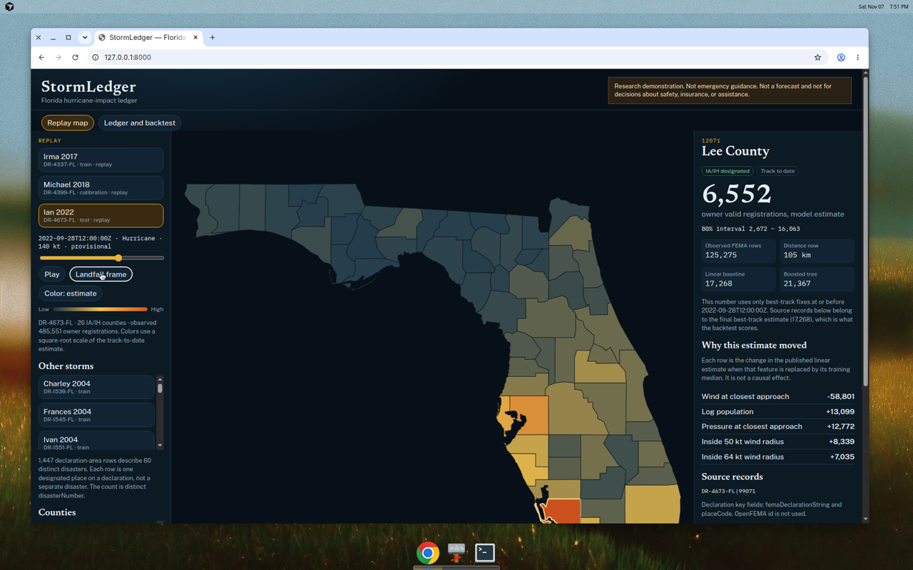
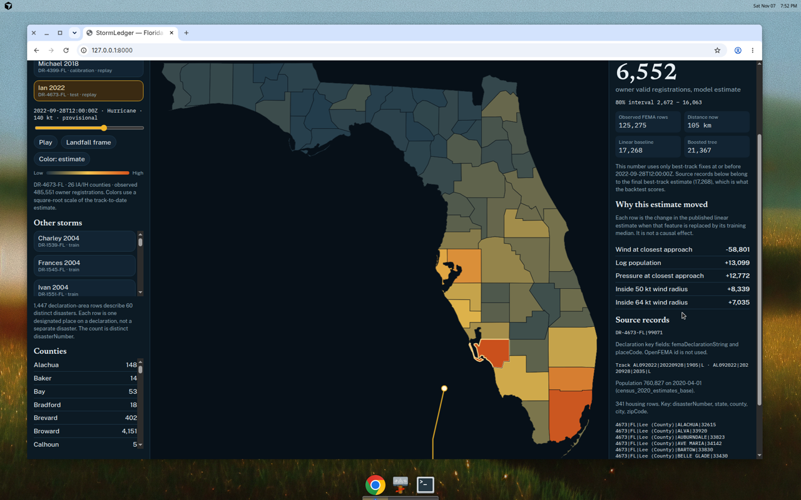
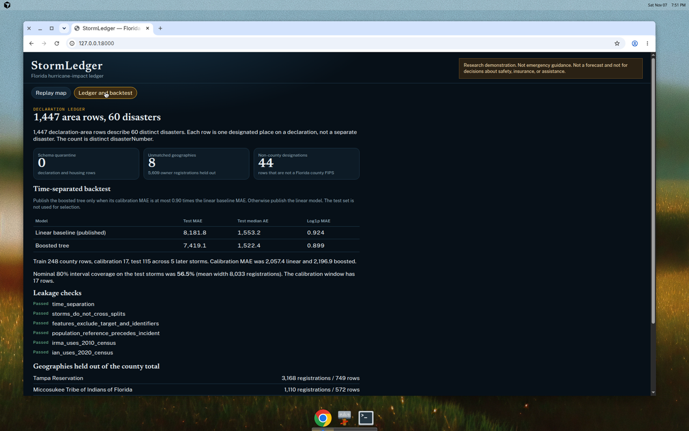

# StormLedger

An explainable, auditable ledger of Florida hurricane impacts. It joins public disaster declarations, owner housing-assistance records, and NHC best tracks, then replays a storm across counties. Every published number can be opened back to the source rows it came from.

**Research demonstration. Not emergency guidance. Not a forecast and not for decisions about safety, insurance, or assistance.**

The modeled outcome is narrow on purpose: **owner valid registrations** from OpenFEMA `HousingAssistanceOwners.validRegistrations`, summed from the published zip/city rows to a Census county FIPS, for counties FEMA designated for Individual Assistance or the Individuals and Households program. It is not the full IA caseload, and it does not include renters.

## Architecture

```mermaid
flowchart LR
  subgraph sources [Public sources]
    FEMA[OpenFEMA declarations and HousingAssistanceOwners]
    HUR[NHC HURDAT2 best track]
    CEN[Census county population]
    GEO[County polygons and FIPS]
  end
  subgraph ingest [Immutable snapshots]
    SNAP[Raw pages and file hashes]
    VAL[Pandera schema and quarantine]
  end
  subgraph warehouse [DuckDB]
    SQL[SQL joins on FIPS and county name]
  end
  subgraph science [Retrospective model]
    MOD[Linear baseline and boosted tree]
    BT[Time-separated backtest]
    PROV[Provenance for every estimate]
  end
  subgraph demo [Local demo]
    API[FastAPI]
    MAP[React and MapLibre replay]
  end
  sources --> SNAP --> VAL --> SQL --> MOD --> BT --> PROV --> API --> MAP
```



Declaration-area rows are not disasters. StormLedger counts `disasterNumber`. In the bundled snapshot, **1,447** Florida hurricane declaration-area rows describe **60** distinct disasters.

Source keys, not API GUIDs:

| Record | Natural key |
| --- | --- |
| Declaration area | `femaDeclarationString` + `placeCode` |
| Housing owner row | `disasterNumber` + `state` + `county` + `city` + `zipCode` |
| Best-track fix | `storm_id` + `YYYYMMDD` + `HHMM` + record identifier |

OpenFEMA `id` is stored only as an API attribute. It is not a StormLedger key.

## Run the demo

Requires Python 3.11+ and Node 20. From a checkout:

```bash
./scripts/start.sh
```

That creates a virtualenv if needed, installs the package, builds the web app, rebuilds the ledger from the bundled snapshots, and serves http://127.0.0.1:8000 .

The map is offline. It draws county polygons and the best track. It does not call a tile server. Pick **Ian 2022**, **Irma 2017**, or **Michael 2018**, press play, and click a county. The panel shows the track-to-date estimate, the 80% interval, the ablation explanation, and the source keys.

Other commands:

```bash
python -m stormledger.cli build     # validate, transform, train, write data/curated
python -m stormledger.cli refresh   # new immutable snapshots from OpenFEMA, NHC, and Census
python -m stormledger.cli serve
pytest -q
cd frontend && npm test && npm run build
```

`build` does not use the network. `refresh` does, and it writes a new snapshot directory instead of overwriting an old one. CI runs the tests against the committed snapshots only.

## Backtest

Target: owner valid registrations on IA/IH-designated Florida counties. Features are distance to the best-track line, wind, pressure, hours nearby, quadrant wind radii, and the log of the latest Census population whose reference date is before the incident. County FIPS and the assistance outcome are not features.

Splits use the incident begin date. Train is before 2018-01-01 (248 county rows). Calibration is 2018 through 2021 (17 rows: Michael and Sally). Test is 2022 onward (115 rows: Ian, Nicole, Idalia, Helene, Milton). The boosted tree is published only if its calibration MAE is at most 90% of the linear MAE. On this run it was not, so the **linear model is published**. The test set was not used to choose.

These figures are from `python -m stormledger.cli build` on the bundled snapshots:

| Model | Test MAE (registrations) | Test median AE | Test MAE on log1p |
| --- | ---: | ---: | ---: |
| Linear baseline, published | 8181.8 | 1553.2 | 0.924 |
| Boosted tree, not selected | 7419.1 | 1522.4 | 0.899 |

Calibration MAE was 2057.4 linear and 2196.9 boosted. The boosted tree is slightly better on the later storms and worse on the calibration window, so the precommitted rule keeps the linear model.

The 80% interval is split conformal on log1p residuals from the 17 calibration rows, mapped back with `expm1`. Empirical coverage on the test storms is **56.5%**, with a mean width of about 8,033 registrations. Michael and Sally are smaller events than Ian, Helene, and Milton, so a radius fit on that window is too narrow. That miss was not tuned away after looking at the test storms.

Details and leakage checks are in [docs/model_card.md](docs/model_card.md).

## Screenshots

Ian at the landfall frame. County color is the track-to-date model estimate.



Lee County during Ian, with the declaration key, housing source rows, and the uncertainty interval.



The ledger separates declaration-area rows from distinct disasters and shows the backtest.



## Limitations

- Best-track positions are a post-storm reanalysis. Early replay frames are not what a forecast office knew at the time.
- Owner registrations omit renters. A missing housing row inside a designated county is treated as zero.
- A few HousingAssistanceOwners rows pair the published county with a city or ZIP in a different county. StormLedger keeps the published county label and shows those rows in the source list instead of re-geocoding them.
- Tribal labels and other names that do not match a Florida county, including about 5,609 owner registrations in this extract, are held out of the county total and listed in the ledger.
- Population is a decennial census count, not a population-weighted centroid. Storms before April 2000 are in the declaration ledger only, because no earlier leakage-safe vintage is in the bundle.
- There are few storms. County rows inside one storm are not independent. Do not use the MAE as a property of future landfalls.
- Estimates for counties FEMA did not designate for IA/IH are extrapolations.
- The 2026 Isaias declaration is in the OpenFEMA extract. The bundled HURDAT2 file has no 2026 best track, so that disaster is counted and not modeled.
- This is not emergency guidance.

## License

MIT. See [LICENSE](LICENSE).
